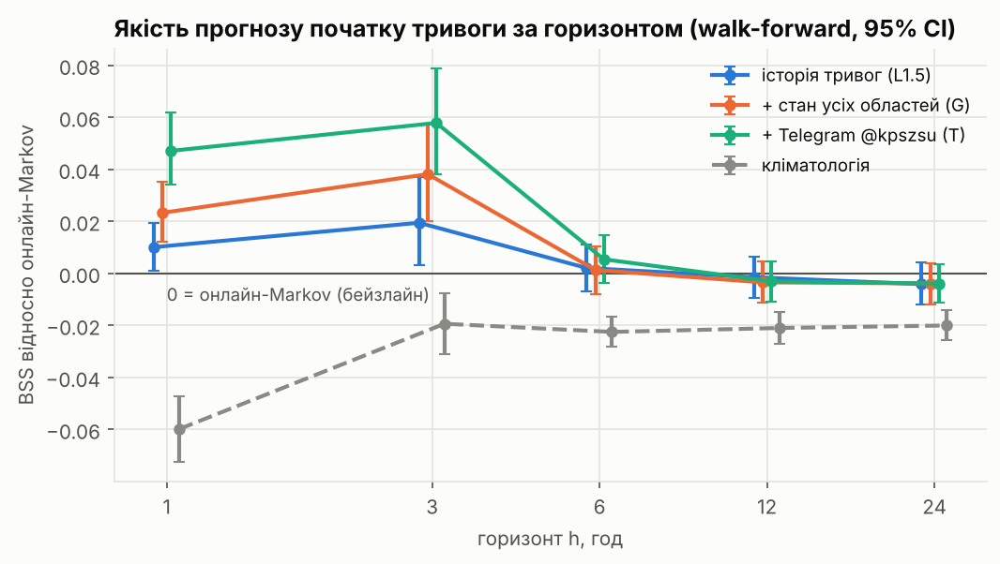
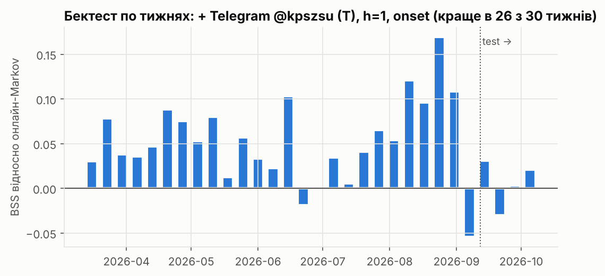
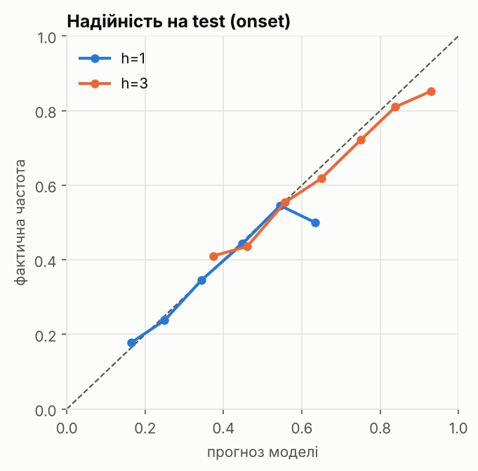
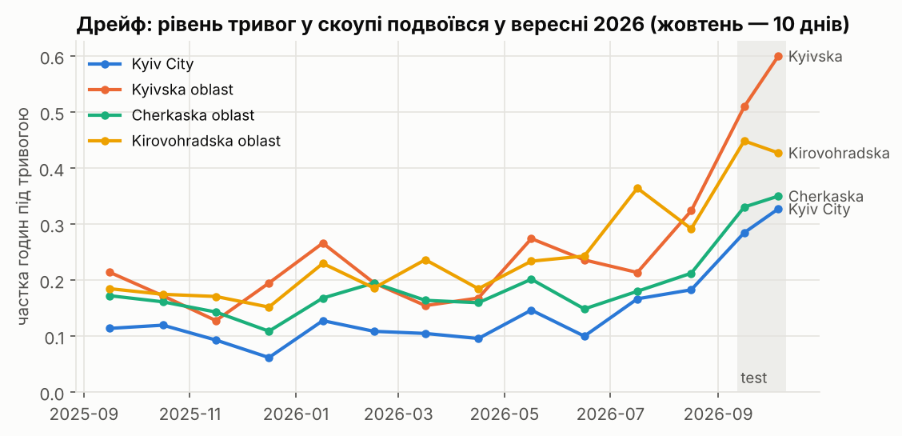

# Ймовірнісний прогноз повітряних тривог

Для кожної години t і області модель дає **ймовірність, що протягом наступних h годин почнеться
повітряна тривога**. Скоуп: м. Київ, Київська, Черкаська, Кіровоградська області. Горизонти
h = 1, 3, 6, 12, 24 год. Оцінка на найсвіжішому періоді (12.09–10.10.2026) і в walk-forward
бектесті (березень–жовтень 2026). Жодна ознака не використовує даних, які з'явилися після моменту прогнозу.

**Головний результат.** Найкраще працює комбінація: історія тривог + поточний стан усіх областей +
пости Повітряних сил (@kpszsu). Для прогнозу початку тривоги на 1 і 3 год вона значуще краща за
найсильніший бейзлайн: BSS **+5.1%** і **+6.2%**, краща у 26 і 25 тижнях із 30. Довше ніж на ~3 год
наперед жодна модель не краща за адаптивну базову частоту.



## Дані

| Джерело | Що | Період |
|---|---|---|
| [Vadimkin/ukrainian-air-raid-sirens-dataset](https://github.com/Vadimkin/ukrainian-air-raid-sirens-dataset), `volunteer_data_en.csv` (MIT) | тривоги по областях, UTC | 25.02.2022 – 11.10.2026 |
| Публічне веб-прев'ю каналу Повітряних сил [t.me/s/kpszsu](https://t.me/s/kpszsu) | 39 950 постів про рух загроз | 24.10.2025 – 12.10.2026 |

Official-набір датасету не використовується: він закінчується 07.09.2026, а з volunteer збігається лише на ~82% годин. Склеювати їх означало б штучно створити злам у тестовому періоді.
Навчання починається з 07.11.2025, коли завершився перехід на районні тривоги
(після нього тривог стало в ~2.5 раза більше).

## Постановка

- **Сітка:** погодинна, в UTC; київський час — лише для ознак «година доби / день тижня».
- **Ціль:** для h ≤ 3 — «будь-яка тривога в (t, t+h]»; для h ≥ 6 — «тривога в годину t+h»
  (вікно на 24 год майже завжди містить тривогу, тож така ціль тривіальна).
- **Головний зріз — onset:** у момент t тривоги немає. Якщо тривога вже триває, ціль для h=1 за
  побудовою дорівнює 1, тому зріз «усі години» частково тривіальний.
- **Метрики:** Brier, log-loss, **BSS** = 1 − Brier/Brier(бейзлайн), ECE і діаграма надійності,
  ROC-AUC. Невизначеність — 95% CI для ΔBrier через **block bootstrap по днях** (години в межах доби залежні).
- **Бейзлайни** (усі онлайн):
  - кліматологія — частота тривог у цю годину доби за 28 днів;
  - **онлайн-Markov** — P(тривога | область, чи триває тривога зараз) за останні 28 днів; найсильніший бейзлайн, бо підлаштовується під рівень.

## Відсутність витоку даних

1. Ознаки в момент t бачать лише години сітки < t і стан на момент t (чи триває тривога, скільки
   хвилин). Пости Telegram враховуються, лише якщо опубліковані раніше ніж за 5 хв до t.
   Відредаговані пости відкидаються.
2. **Тест обрізання** (`tests/test_features.py`): ознаки рахуються двічі, з усіх даних і з даних, обрізаних у момент t0.
   Для всіх моментів ≤ t0 кожна з ~100 ознак мусить збігтися. Окремий тест перевіряє буфер 5 хв для постів.
3. Хронологічні спліти з purge: рядок не потрапляє в train, якщо його ціль заходить у val/test.
   Скейлер і калібратор вчаться лише на минулому.
4. Онлайн-бейзлайни й калібратор використовують лише цілі, які вже спостережені до t (зсув на h).
5. Хвіст даних обрізано на 24 год: тривоги, що ще тривали в момент завантаження, у CSV відсутні.

## Модель

`src/backtest.py` — **walk-forward**:
- LightGBM (одна модель на 4 області) вчить **логіт-поправку до онлайн-Markov**
  (`init_score`): дерева не екстраполюють, а бейзлайн сам підлаштовується під рівень тривог;
- перенавчання щотижня з 01.02.2026, тобто всі прогнози out-of-sample;
- **онлайн-рекалібрування Platt** щодоби на вікнах 7/14/28/56 днів і **середнє** чотирьох калібраторів (`wf_*_ens`).

| Набір ознак | Що містить |
|---|---|
| L1 | лаги й ковзні частки тривог, стан поточної тривоги, час від відбою, онлайн-кліматологія і Markov, календар (для t і t+h) |
| L1.5 | сусіди «вгору за маршрутом», к-сть областей під тривогою, масовані атаки (≥16 областей) |
| G | стан **усіх 24 областей**: чи триває тривога і скільки хвилин від її початку; модель сама вчить маршрути |
| T | Telegram @kpszsu: типи загроз (шахед, реактивний БпЛА, балістика, ракета, КАБ, «в укриття», стратегічна авіація) і згадки області, сусідів, міст за 30 хв / 1 год / 3 год |

**Фінальна модель:** `wf_L1.5GT_ens` (L1 + L1.5 + G + T, ансамбль рекалібрування).

## Результати

### Walk-forward бектест (18.03–10.10.2026, onset), BSS відносно онлайн-Markov, 95% CI

| Модель | h=1 | h=3 | h=6 | h=12 | h=24 |
|---|---|---|---|---|---|
| кліматологія | −6.0% | −1.9% | −2.2% | −2.1% | −2.0% |
| історія тривог (L1.5) | +1.0% [0.1; 1.9] | +1.9% [0.3; 3.7] | +0.2% | −0.1% | −0.4% |
| + стан усіх областей (G) | +2.3% [1.2; 3.5] | +3.8% [2.0; 5.8] | +0.1% | −0.3% | −0.4% |
| **+ Telegram (T)** | **+5.1% [3.8; 6.5]** | **+6.2% [4.2; 8.3]** | +0.5% [−0.5; 1.4] | −0.2% | −0.4% |

Приріст від Telegram відносно G значущий: ΔBrier h=1 −0.0036 [−0.0046; −0.0027], h=3 −0.0052 [−0.0070; −0.0036].

### Test — останні 4 тижні (12.09–10.10.2026), onset

| | h=1 Brier | h=1 BSS | h=3 Brier | h=3 BSS |
|---|---|---|---|---|
| кліматологія | 0.2182 | −7.0% | 0.2191 | −1.9% |
| онлайн-Markov | 0.2040 | 0 | 0.2149 | 0 |
| **фінальна модель** | **0.2027** | **+0.6%** | **0.2120** | **+1.4%** |

ECE фінальної моделі на test: 0.017 (h=1), 0.031 (h=3). На 4 тижнях (~28 незалежних діб) різниця
з Markov статистично не розрізняється, тому основний доказ — бектест на ~7 місяцях.



### Як це читати

- **ROC-AUC** (бектест, h=1, onset): 0.714 проти 0.644 в онлайн-Markov і 0.5 у монетки.
- **Практичне правило (h=1):** коли модель дає ≥ 0.4, тривога починається протягом години в 47%
  випадків; коли нижче — у 14%. Так буває у 7% «спокійних» годин, і в них припадає 20% усіх стартів тривог.
- **Що робить Telegram:** якщо Повітряні сили згадали область за останні 30 хв, тривога в наступну годину
  починається в 38% випадків проти 12.5% без згадки.
- **По областях** (h=1, бектест): найбільший виграш для Київщини (BSS +9.8%, AUC 0.76). Для Києва,
  Черкащини й Кіровоградщини +2–4%.



## Що не спрацювало (і чому це важливо)

- **Дрейф.** У вересні 2026 рівень тривог у скоупі подвоївся: ~210 тривог на місяць на область проти ~80, вони коротшають.
  Статичний Markov, вивчений на train, на тесті виявився гіршим за кліматологію. Звідси онлайн-бейзлайни, логіт-поправка і щотижневе перенавчання.
- **Val ≠ test.** Val (15.08–12.09) сам припав на перехідний період. Тричі вибір за val
  розходився з тестом: ознаки серій атак, G в одноразовій моделі, сира модель проти ансамблю. Тому
  набори ознак порівнюються на всьому walk-forward бектесті.
- **Telegram без перенавчання й рекалібрування шкодить.** Та сама модель L1.5+G+T, навчена один раз
  (`src/train.py`), на test гірша за Markov (BSS −5.8% / −6.0%): у середньому вона прогнозує 0.41 при
  фактичній частоті 0.31 (ECE 0.10). У вересні постів @kpszsu вдвічі більше, ніж у train, і лічильники згадок
  виходять за діапазон навчання. Розрізнення не погіршилось (AUC 0.64 проти 0.63), зламалась шкала, і
  щотижневе перенавчання + онлайн-рекалібрування це виправляють. Що багатші ознаки, то потрібніша адаптація.
- **Серії атак** (довжина серій «важких діб» і т. п.) дали приріст на val і нуль на тесті. Ознака «середня
  довжина серій за 90 днів» стала «міткою періоду», тобто модель перенавчилась на режим.
- **Гіпотеза «після довгої тривоги — затишшя»** не підтвердилася: атаки йдуть серіями (P(тривога сьогодні)
  0.95 після важкої доби проти 0.76 після спокійної).
- **Жовтих/червоних тривог і типу загрози** в датасеті немає. Тип загрози береться лише з Telegram.



## Обмеження

- Тест бачили кілька разів у процесі розробки (v1 → v2 → рекалібрування → G → T). Тому
  головний доказ — walk-forward бектест, але val, на якому обирали варіанти, входить у цей період.
- У веб-прев'ю Telegram не видно часу редагування поста (позначок «edited» не знайдено). Якщо пост доповнювали,
  частина тексту могла з'явитися пізніше за мітку часу. Видалені пости відсутні.
- Зростання кількості коротких тривог у 09.2026 може бути частково зміною способу запису.
  Перевірити неможливо: official-набір закінчується 07.09.2026.
- Volunteer-дані: ~5% тривог без відбою мають штучну тривалість +30 хв.

## Відтворення

```bash
pip install -r requirements.txt
python -m src.data_loader volunteer --force          # свіжі CSV → data/processed/
python -m src.telegram_web kpszsu --since 2025-10-25 # ~40 хв, без логіну; повтор = докачка нових постів
# або (краще, з часом редагування постів) — Telethon, див. розділ «Telegram через Telethon»
pytest -q tests/                                     # тести вирівнювання і витоку даних
python -m src.train 1 3                              # train/val/test, абляція (reports/summary_h1_3.md)
python -m src.backtest 1 3                           # walk-forward (reports/backtest_summary.md)
python -m src.backtest 6 12 24
python -m src.plots                                  # reports/figures/
```

| Файл | Що |
|---|---|
| `src/data_loader.py` | завантаження, злиття інтервалів, погодинна сітка UTC |
| `src/features.py` | ознаки L1 / L1.5 / S / G, цілі, онлайн-бейзлайни |
| `src/text_features.py`, `src/telegram_web.py` | Telegram: збір і ознаки |
| `src/evaluate.py` | спліти з purge, метрики, bootstrap, надійність |
| `src/train.py` | train/val/test, абляція, LogReg-контроль |
| `src/backtest.py` | walk-forward, онлайн-рекалібрування, ансамбль |
| `src/telegram_scraper.py` | альтернативний збір через Telethon (з логіном) |
| `CLAUDE.md` | постановка, правила і повний журнал рішень |

## Telegram через Telethon (офіційний API)

Веб-прев'ю не показує, коли пост редагували. Telethon віддає `edit_date`, і тоді
`available_at = edit_date`: відредагований текст враховується лише з моменту редагування. Якщо поруч
лежить `data/raw/telegram/kpszsu.parquet` (Telethon), пайплайн бере його замість веб-версії.

1. Отримати `api_id` і `api_hash`: https://my.telegram.org/apps → *API development tools*.
2. `pip install telethon` (якщо падає збірка `pyaes`, спершу `pip install -U pip setuptools wheel`).
3. Задати ключі й запустити з кореня репозиторію:
   ```powershell
   # Windows PowerShell
   $env:TG_API_ID="12345"; $env:TG_API_HASH="abc..."
   python -m src.telegram_scraper kpszsu --since 2025-10-25
   ```
   ```bash
   # Linux / macOS
   export TG_API_ID=12345 TG_API_HASH=abc...
   python -m src.telegram_scraper kpszsu --since 2025-10-25
   ```
   Перший запуск попросить номер телефону і код з Telegram (вводите лише у своєму терміналі).
   Повторний запуск докачує тільки нові пости. Наприкінці скрипт друкує статистику редагувань.
4. `air_alerts_session.session` — це повний доступ до акаунта. Файл у `.gitignore`, **не комітьте його й нікому не передавайте**.
   Сам `kpszsu.parquet` містить лише публічні пости каналу. Щоб запустити пайплайн на ньому в іншому
   середовищі: `git add -f data/raw/telegram/kpszsu.parquet`.

## Рефлексія

**Що пішло не так:** перша модель «перемагала» лише на val. Тест припав на ескалацію (рівень тривог ×2),
і статичний бейзлайн та дерева, які не екстраполюють, зламались. Нові ознаки з історії тривог (серії атак,
сусіди) давали приріст на val і нуль на тесті.
**Як змінили підхід:** перейшли на онлайн-бейзлайн із логіт-поправкою, щотижневе перенавчання і
ансамбль рекалібрування. Оцінювати почали на 7-місячному walk-forward замість 4 тижнів. Головне — додали
нове джерело інформації: пости Повітряних сил про рух загроз.
**Чому фінальна версія краща:** вона чесно калібрована і значуще краща за найсильніший бейзлайн
(BSS +5–6% для 1–3 год, у 26 з 30 тижнів), а не лише на val.
